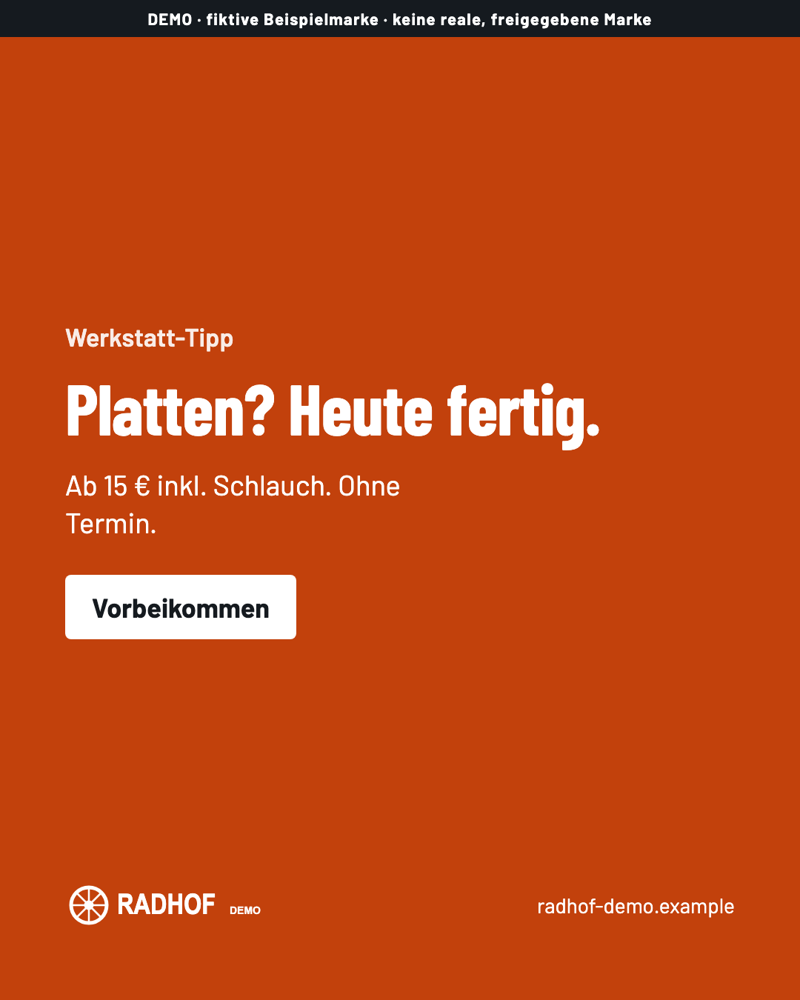
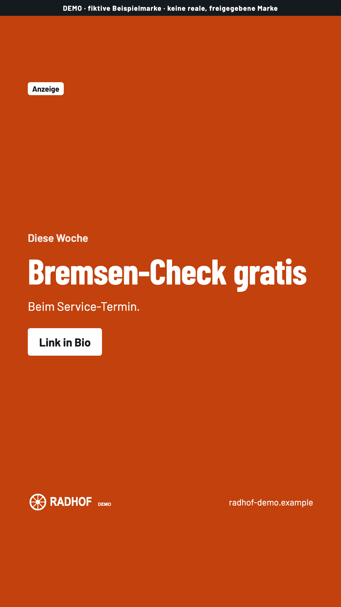
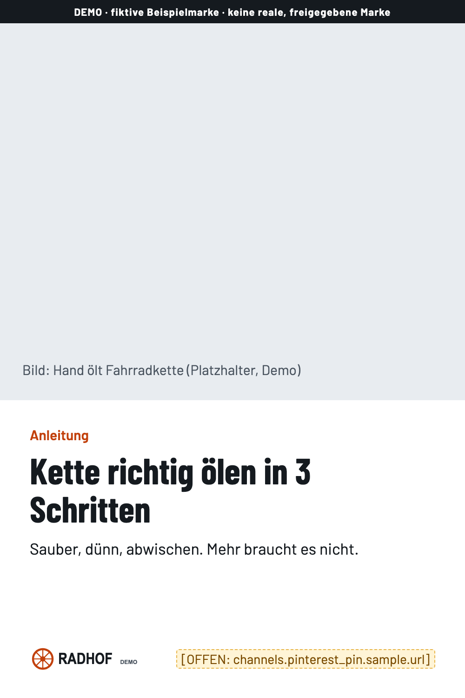
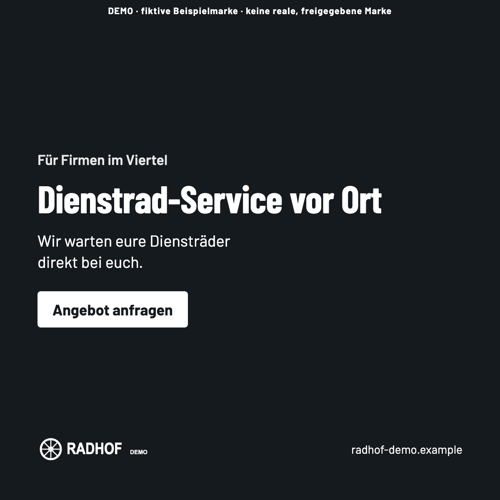

# Personal Design System

> **PERSONAL DESIGN SYSTEM v1.1** · Core 1.1.0 · Stand 2026-10-09 · [Changelog](core/CHANGELOG.md)

Ein persönliches, projektunabhängiges Design-System. Es liefert die **Regeln, Systematik, Prozesse und Qualitätsstandards**, mit denen jedes neue Projekt eine eigene Marke und eigene Oberflächen bekommt: SaaS, lokales Unternehmen, E-Commerce, Dienstleistung, App, persönliche Marke oder etwas ganz anderes.

Es liefert **keine** fertige Optik. Jedes Projekt hat seine eigene Marke.

> **English summary:** A reusable, AI-assisted personal design system. `core/` holds brand-neutral rules (accessibility, responsive design, token architecture, component behavior, template structures, project workflow with approval gates). Each project in `projects/` builds its own brand and design system on top of it. Claude Code follows [`core/agent-skill/SKILL.md`](core/agent-skill/SKILL.md). Documentation is in German.

> **Schnellstart auf einer Seite:** [PERSONAL-DESIGN-SYSTEM-QUICKSTART.pdf](PERSONAL-DESIGN-SYSTEM-QUICKSTART.pdf) · Quelldatei zum Aktualisieren: [quickstart/PERSONAL-DESIGN-SYSTEM-QUICKSTART.html](quickstart/PERSONAL-DESIGN-SYSTEM-QUICKSTART.html)

---

## In 30 Sekunden

| Frage | Antwort |
|---|---|
| **Was gehört in Core?** | Alles, was für *jedes* Projekt gilt: Accessibility, Responsive, Token-Architektur und -Namen, Farbrollen (nicht Farben), Typo-Systematik (nicht Schriften), Spacing, Komponenten-Verhalten, Template-Strukturen, Prozesse, Gates, Qualitätsprüfungen. → [`core/`](core/README.md) |
| **Was gehört in Projects?** | Alles, was eine Marke ausmacht: Brief, Positionierung, Tonalität, Farben, Schriften, Logo, Bildsprache, Creative Direction, eigene Komponenten und Templates. → `projects/<name>/` |
| **Wie starte ich ein neues Projekt?** | Claude sagen: *„Ich möchte ein neues Projekt X erstellen. Verwende mein Personal Design System.“* Oder von Hand: [`core/process/project-template/`](core/process/project-template/) nach `projects/<name>/` kopieren und [Bootstrap](core/process/project-bootstrap.md) folgen. |
| **Wie arbeitet Claude damit?** | nach dem [Agent Skill](core/agent-skill/SKILL.md): Core lesen → Projekt anlegen → Brief → Brand Foundation → Creative Directions → **du entscheidest** → Tokens → Components → Templates → Prüfung. An jedem [Gate](core/agent-skill/rules/approval-gates.md) wartet Claude auf deine Freigabe. |
| **Wo liegen Tokens?** | Systematik und Pflicht-Tokens: [`core/tokens/`](core/tokens/README.md). Werte eines Projekts: `projects/<name>/tokens/`. |
| **Wie entsteht ein Brand Kit?** | Nach den Tokens: `brand-kit/brand-kit.json` füllen, `python3 core/brand-kit/generator/build_brand_kit.py …` erzeugt BRAND-KIT.html/.pdf, `brand.css`, Kanal-Grafiken (Website, Instagram, Pinterest, LinkedIn, Newsletter, Präsentation, Angebot) und einen QA-Bericht. Freigabe mit G4. → [`core/brand-kit/`](core/brand-kit/README.md) |
| **Und für ChatGPT & Co.?** | `export_ai_context.py` erzeugt das AI Brand Context Pack mit Datenschutzprüfung. Hochladen nur nach deiner Freigabe. |
| **Wo liegen Components?** | Verhalten, Zustände, Accessibility: [`core/components/`](core/components/README.md). Aussehen und Projektkomponenten: `projects/<name>/components/`. |
| **Wie wird Core weiterentwickelt?** | Nur über [Promotion](core/process/promotion.md): Projekte markieren `[CORE-KANDIDAT]`, du entscheidest, dann Eintrag im Changelog und neue Version ([Governance](core/process/governance.md)). Core wird nie stillschweigend geändert. |

---

## Struktur

```
personal-design-system/
├── README.md              ← du bist hier
├── AGENTS.md              Einstieg für AI Agents (verweist auf den Agent Skill)
├── CLAUDE.md              lädt AGENTS.md für Claude Code
│
├── core/                  PROJEKTUNABHÄNGIG · Version 1.0.0
│   ├── README.md          Inhaltsverzeichnis
│   ├── CHANGELOG.md
│   ├── principles/        Designprinzipien, Accessibility, Responsive, Interaction, Content, Qualität, Doku, Assets
│   ├── tokens/            Architektur, Namen, Rollen, Skalen, contract.tokens.json, defaults.tokens.json
│   ├── components/        24 Komponenten-Spezifikationen + Spec-Vorlage
│   ├── templates/         Website, Marketingseite, Transaktionsablauf, App/Dashboard, Dokument, Präsentation, Brand-Guideline, Cross-Channel, Social Media, Newsletter
│   ├── brand-kit/         Brand-Kit-Vertrag, Generator, Kanal-Starter, AI-Export, Tests
│   ├── process/           Workflow & Gates, Bootstrap, Creative Direction, Promotion, Governance, project-template/
│   ├── patterns/          unverbindliche Muster
│   ├── decisions/         warum Core so ist, wie er ist
│   └── agent-skill/       SKILL.md, rules/, examples/
│
├── projects/              EIN ORDNER JE PROJEKT (siehe projects/README.md)
└── demo/                  fiktive Demo-Marke „Radhof (Demo)“ zum Testen, keine reale Marke
```

## Ein neues Projekt: der Ablauf

```
0 Setup → 1 Brief → 2 Brand Foundation → (3 Research) → 4 Creative Direction → 5 Tokens & Brand Kit → 6 Components → 7 Templates & Kanäle → 8 Release
      G0        G1                 G2                                     G3            G4             G5             G5          G6
```

- **Prozess-Tiefe** S (klein, z. B. Landingpage eines Handwerksbetriebs), M (Standard) oder L (große neue Marke). Details in [project-workflow.md](core/process/project-workflow.md).
- **Bestehende Marke?** Dann Brand-Import statt neuer Creative Directions.
- **Nie ohne dich:** Name, Richtung, Farben, Schriften, Logo, Anrede, Preise, Veröffentlichung.

## Wichtigste Regeln auf einen Blick

1. Accessibility-Baseline **WCAG 2.2 AA** in jedem Projekt, verschärfbar, nie absenkbar.
2. **Token-first:** primitive → semantic → component; Komponenten nutzen nie Rohwerte.
3. **Core schreibt keinen Stil vor.** Keine Farben, Schriften, Radien oder Schatten im Core.
4. **Mobile first**, lauffähig ab 320 px und mit 200 % Zoom.
5. **Nie nur Farbe** für Bedeutung.
6. **Claude bereitet vor, du entscheidest** (Gates G0–G6).
7. **Projekt → Core nur über Promotion.**

## Visual Brand Kit Demo

> **DEMO · „Radhof (Demo)“ ist eine fiktive Beispielmarke**, keine reale und keine freigegebene Marke. Name, Farben, Schriften, Logo, Adressen und Texte sind erfunden und gelten nur im Ordner [`demo/radhof-demo/`](demo/radhof-demo/README.md).

Erzeugt mit `python3 core/brand-kit/generator/build_brand_kit.py demo/radhof-demo/brand-kit/brand-kit.json`:

- **Brand Kit als PDF** (wird auf GitHub direkt angezeigt): [BRAND-KIT.pdf](demo/radhof-demo/brand-kit/dist/BRAND-KIT.pdf)
- Brand Portal als HTML: [BRAND-KIT.html](demo/radhof-demo/brand-kit/dist/BRAND-KIT.html) (GitHub zeigt den Quelltext. Zum Ansehen herunterladen bzw. lokal öffnen.)
- Prüfbericht: [QA-REPORT.md](demo/radhof-demo/brand-kit/dist/QA-REPORT.md)
- Kanal-Ausgaben: [Präsentation (PDF)](demo/radhof-demo/brand-kit/dist/channels/presentation.pdf) · [Angebot (PDF)](demo/radhof-demo/brand-kit/dist/channels/document-offer.pdf) · [LinkedIn Carousel (PDF)](demo/radhof-demo/brand-kit/dist/channels/linkedin-carousel.pdf)

| Instagram Post | Instagram Story | Pinterest Pin | LinkedIn Post |
|---|---|---|---|
|  |  |  |  |

Der Status des Demo-Kits ist bewusst **ENTWURF**, und es enthält absichtlich **OFFEN**-Punkte (z. B. die fehlende Ziel-URL im Pinterest Pin), um die Kennzeichnung zu zeigen. Das AI Brand Context Pack der Demo wird nicht veröffentlicht. Es entsteht lokal mit `export_ai_context.py`.

## Pilotprojekt Digital Legacy

Das Pilotprojekt war der Stresstest, an dem dieses System entwickelt wurde (Brief, Brand Foundation, drei Creative-Direction-Explorationen). Es ist **unfertig, pausiert und privat**, deshalb nicht Teil dieses öffentlichen Repositorys. Keine Richtung ist gewählt, offene Geschäftsentscheidungen bleiben offen. Seine visuelle Identität ist **nicht** Teil von Core. Welche Erkenntnisse übernommen wurden, steht in [core/decisions/0001](core/decisions/0001-audit-core-kandidaten.md).

## Grenzen

Noch nicht enthalten: Build-Adapter für Tailwind, React, PPTX und DOCX (nur `brand.css` als minimaler CSS-Adapter), weitere Komponenten (Dropdown-Menü, Combobox, Datumsauswahl, Avatar, Fortschritt, Chip, Datei-Upload), Figma-Bibliothek. Brand Kit und AI-Export sind nur mit einer fiktiven Demo-Marke getestet. Details in [core/decisions/0003](core/decisions/0003-smoke-test-v1.md) und [core/decisions/0005](core/decisions/0005-test-v1-1.md).
